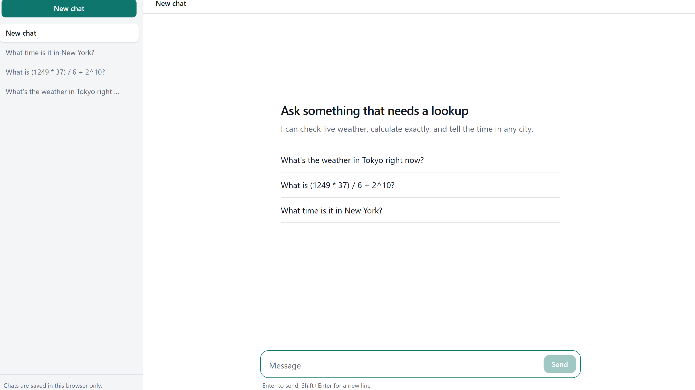
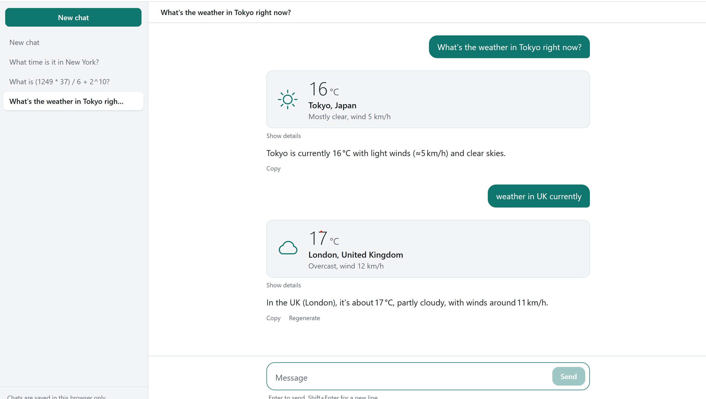
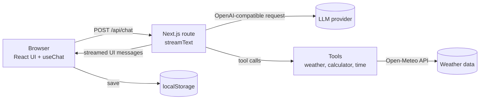

# Chat with tools

A streaming AI chat app built with Next.js and the Vercel AI SDK. The model can call tools (live weather, exact math, time in any city), and the results render as purpose-built UI instead of plain text.

**Live demo:** https://ai-chat-eta-nine.vercel.app/

<!-- Add a screenshot or GIF: save it as docs/screenshot.png and keep the line below -->




## What it does

- Streams responses token by token, with a Stop button and Regenerate.
- **Tool calling.** The model decides when to call `getWeather`, `calculator`, or `getCurrentTime`, reads the result, and answers.
- **Tool results as UI.** The weather result is a card with temperature, an icon, and the location. The calculator shows `expression = result`. Raw input and output are available under "Show details".
- **Saved conversations.** A sidebar lists chats; they are stored in the browser's localStorage and survive a refresh.
- Markdown rendering with copy buttons on code blocks, auto-growing composer, "Jump to latest" scrolling, error state with retry, light and dark themes, and a mobile layout.

## Architecture



The API key never reaches the browser. The browser only talks to `/api/chat`, and the route talks to the model provider.

## Design decisions

- **Provider-swappable.** The model is created from three environment variables (`LLM_BASE_URL`, `LLM_API_KEY`, `LLM_MODEL`) using an OpenAI-compatible client. Moving between Groq, Gemini, OpenRouter, or a paid model is a config change, not a code change. I built this on free tiers.
- **No `eval` in the calculator.** Expressions go through a small recursive-descent parser that only accepts numbers, operators, and parentheses.
- **Tool loop with a step cap.** `stopWhen: stepCountIs(5)` lets the model call a tool, read the result, and answer, while preventing runaway loops.
- **Reasoning-model compatibility.** Some reasoning models return `reasoning_content`, which Groq rejects when it is sent back in the next step of a tool loop. A small model middleware strips reasoning parts before each request (`src/lib/model.ts`).
- **Hydration-safe persistence.** Chats are read from localStorage after mount, so server and client render the same HTML.
- **Basic abuse limits.** Messages are capped at 2,000 characters and requests are rate-limited per IP.

## Project structure

```
src/
  app/
    api/chat/route.ts     streaming endpoint, limits, tool loop
    layout.tsx, page.tsx, globals.css
  components/
    Chat.tsx              app shell: chat list state + persistence
    ChatThread.tsx        one conversation: useChat, scrolling, errors
    Sidebar.tsx           chat list, new chat, delete
    Composer.tsx          auto-growing input, send/stop
    MessageView.tsx       user and assistant messages
    ToolCard.tsx          weather, calculator, and time result UI
    Markdown.tsx, CopyButton.tsx
  lib/
    model.ts              provider config + reasoning middleware
    tools.ts              tool definitions
    chats.ts              types and localStorage helpers
```

## Run it locally

Requires Node.js (current LTS).

```bash
git clone https://github.com/farheen14ecom-droid/ai_chat.git
cd ai_chat
npm install
cp .env.example .env.local    # on Windows Command Prompt: copy .env.example .env.local
```

Edit `.env.local` and fill in one provider, then:

```bash
npm run dev
```

Open http://localhost:3000.

### Environment variables

| Name | Example | Purpose |
|---|---|---|
| `LLM_BASE_URL` | `https://api.groq.com/openai/v1` | OpenAI-compatible endpoint |
| `LLM_API_KEY` | your key | Provider API key (server-side only) |
| `LLM_MODEL` | `openai/gpt-oss-120b` | Model ID. Check your provider's current model list |

Never commit `.env.local`. It is listed in `.gitignore`.

## Deployment

Deployed on Vercel's free Hobby plan:

1. Import the GitHub repo in Vercel.
2. Add the three environment variables in **Settings, Environment Variables**.
3. Deploy. Each push to `main` redeploys automatically. After changing an environment variable, redeploy so it takes effect.

The public demo uses a rate-limited free-tier key, so it may occasionally return a rate-limit error.

## Troubleshooting notes

Problems I hit while building this, in case they help you:

| Symptom | Cause and fix |
|---|---|
| `model_not_found` | The model ID is retired or unavailable to the key. List what your key can use at `/openai/v1/models` and update `LLM_MODEL`. Do not add a `groq/` prefix to regular models. |
| `reasoning_content is unsupported` | Reasoning model output sent back to the provider. Fixed by the middleware in `model.ts`. |
| `Unknown at rule: @theme` | Tailwind v4 is not being processed. Install `tailwindcss` and `@tailwindcss/postcss` v4 and add a `postcss.config.mjs` with the `@tailwindcss/postcss` plugin. |
| "page.tsx doesn't have a root layout" | `src/app/layout.tsx` is missing. |

## Known limitations

- The rate limiter is in-memory, so it resets when the serverless function restarts. A production version would use a shared store such as Redis.
- Chats live in the browser only. There are no accounts, and clearing site data deletes them.
- Free-tier models are weaker than top paid models at multi-step tool use, and free tiers have rate limits that can change.
- There is no automated test suite or evaluation yet.

## What I would improve next

- Add an eval set of prompts with expected tool calls, run in CI, to catch regressions when the model or prompt changes.
- Move chat storage to a database (Postgres) with authentication.
- Add tool-call approval for actions with side effects.
- Add tracing for latency and cost per conversation.
- Retrieval over my own documents (next project: RAG with pgvector).

## Tech stack

Next.js (App Router), React, TypeScript, Tailwind CSS v4, Vercel AI SDK, react-markdown, Open-Meteo API.